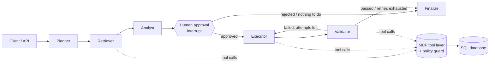

# Multi-Agent Enterprise Workflow Automation

**Python · LangGraph · FastAPI · MCP · SQL**

A multi-agent system that automates enterprise workflows end to end, with specialised agents for
**planning, retrieval, analysis and execution**, MCP-based tool integration, and **human-in-the-loop
approval checkpoints** so nothing is written to a system of record without sign-off.

The reference scenario is **invoice processing** (approve / reject / flag pending invoices), but the
architecture is domain-agnostic: swap the tools and the analyst policy to automate procurement,
HR onboarding, ticket triage, etc.

## Architecture



| Agent | Responsibility | Tool access |
|---|---|---|
| **Planner** | NL request → validated `Plan` (Pydantic). LLM-backed, with a rule-based fallback | none |
| **Retriever** | Fetches matching records + full ledger context | read tools |
| **Analyst** | Applies policy (verified vendor, spend limit, duplicate detection); *proposes* writes | none |
| **Approval gate** | LangGraph `interrupt()` pauses the graph; a human approves, rejects or excludes items | none |
| **Executor** | Applies only approved writes; idempotent so retries are safe | write tools |
| **Validator** | Independently re-reads the DB to confirm each write took effect | read tools |

### Key design decisions
- **MCP tool layer** – tools are exposed by a real MCP server (`app/mcp_server.py`). Set
  `MCP_TRANSPORT=stdio` and agents call tools through the MCP protocol; `local` calls them in-process.
- **Policy guard** – every tool carries a risk level. `write` tools raise `PermissionError` unless a named
  approver is supplied, so a bug or a hallucinating agent *cannot* mutate data without a human decision.
- **Human-in-the-loop** – state is checkpointed at the interrupt; the run resumes via
  `Command(resume=...)` when the reviewer responds through the API. Reviewers can exclude individual items.
- **Error handling & validation** – executor failures are caught, audited and retried (bounded by
  `MAX_EXEC_ATTEMPTS`); the validator verifies outcomes against the database rather than trusting the executor.
- **Audit trail** – every agent action, approval and failure is written to an SQL `audit_log`.
- **Runs offline** – no API key needed. Set `ANTHROPIC_API_KEY` to let an LLM plan and summarise;
  any LLM/parse failure falls back to deterministic logic.

## Quick start

```bash
python -m venv .venv && source .venv/bin/activate
pip install -r requirements.txt
cp .env.example .env
uvicorn app.main:app --reload          # http://localhost:8000/docs
pytest -q                              # 8 tests, incl. a real MCP stdio round-trip
```

### Try it
```bash
# 1. Start a workflow – it runs planner→retriever→analyst, then pauses for approval
curl -s -X POST localhost:8000/workflows -H 'content-type: application/json' \
  -d '{"request": "Approve all pending invoices"}'

# 2. Review pending_approval in the response, then decide (you can exclude items)
curl -s -X POST localhost:8000/workflows/<run_id>/approval -H 'content-type: application/json' \
  -d '{"approved": true, "approver": "alice", "excluded_invoice_ids": ["INV-1002"]}'

# 3. Inspect the audit trail
curl -s localhost:8000/workflows/<run_id>/audit
```

With the seeded data the analyst approves clean invoices and **flags** `INV-1004` (unverified vendor),
`INV-1005` (over the auto-approve limit) and `INV-1006` (duplicate of `INV-1003`).

## API
| Method | Path | Purpose |
|---|---|---|
| POST | `/workflows` | Start a workflow from a natural-language request |
| GET | `/workflows/{id}` | Status, state and any pending approval |
| POST | `/workflows/{id}/approval` | Approve / reject / exclude items and resume |
| GET | `/workflows/{id}/audit` | Full audit trail |

## Project layout
```
app/
  agents/        planner, retriever, analyst, executor, validator
  graph.py       LangGraph state machine + approval gate + retry routing
  mcp_server.py  MCP server exposing the tools
  mcp_client.py  tool client with write-approval policy guard (local | stdio)
  tools.py       SQL-backed business tools
  db.py          schema, seed data, runs / approvals / audit log
  main.py        FastAPI service
tests/           HITL pause/resume, rejection, exclusions, retries, policy guard, MCP stdio
```

## Production hardening (next steps)
Swap `MemorySaver` for a persistent checkpointer (SQLite/Postgres), SQLite for Postgres, pool the MCP
session, add authentication and role-based approver permissions, and add notifications (Slack/email) for pending approvals.
